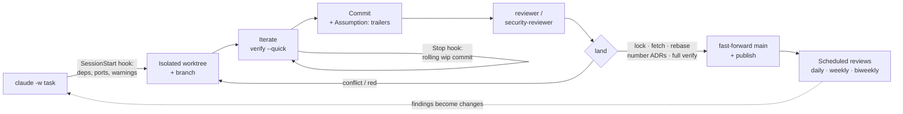

<div align="center">


# Agentic Coding Swarm Protocol

### Run dozens of coding agents on one repo. Main stays green.

**The battle-tested engineering playbook for teams that ship with Claude Code, Codex and other coding agents:<br>
parallel sessions without collisions, one verification gate, always-green integration, and reviews that run themselves.**

[](LICENSE)
[](#install-as-a-claude-code-plugin)
[](AGENTS.md)
[](https://github.com/AntoniArco/agentic-coding-swarm-protocol/actions/workflows/validate.yml)

[Quick start](#quick-start) · [How it works](#how-it-works) · [Manual](#the-manual) · [Plugin](#install-as-a-claude-code-plugin) · [Adoption](ADOPTION.md) · [Integration contract](INTEGRATION.md) · [For agents](AGENTS.md)

</div>

---

## Why this exists

Coding agents made writing code cheap. They did not make *integrating* it cheap. Once a team runs several agent
sessions against the same repository, the bottlenecks move:

- sessions overwrite each other's files and leak work into each other's commits;
- "done" means "looks done", because nothing forced a check to run;
- local checks and CI drift apart, and people learn to trust only one of them;
- architecture rules live in a document that nobody — human or model — re-reads;
- debt, flaky tests and security gaps pile up silently while every gate stays green;
- token bills grow faster than shipped work.

This playbook is the workflow that fixed those problems in **PLINNG**, a production multi-agent platform built with
dozens of parallel agent sessions per day. PLINNG is the reference project throughout: all of its engineering knowledge is here, only product specifics stay out. Every rule comes with **why it exists**, **the incident that motivated it**, **the
mechanism that enforces it**, and **a template you can drop into your own repo**.

> **Battle-tested, not theorized.** Distilled from months of very intensive, agent-heavy development on a production
> system: hundreds of thousands of lines of TypeScript, 750+ commits, 500+ test files, ~90 architecture decision
> records and hundreds of serialized lands and deploys, with zero broken builds on the integration branch. Along the
> way it caught and permanently closed a 173,000-directory temp-file leak, a 405-commit silent history divergence,
> ADR numbering collisions and cross-session overwrites.

## The ten principles

| # | Principle | Enforced by |
|---|---|---|
| 1 | **Deterministic beats persuasive.** What must never fail goes into hooks, deny rules, tests and scripts — not into louder prompts. | hooks, `deny` rules, CI |
| 2 | **One session = one worktree = one branch.** Nobody edits the main checkout. | `SessionStart` hook, `land` |
| 3 | **One verification gate, identical locally and in CI.** A fast tier to iterate, a full tier to finish. | `verify` |
| 4 | **Serialized, always-green integration.** Rebase, verify, fast-forward under a lock. Conflicts go back to whoever caused them. | `land` |
| 5 | **Done = verified.** No evidence (command + output), no "done". | `Stop` hook, reviewer agent |
| 6 | **Docs are part of the change.** A test fails when docs cite things that don't exist or structure goes undocumented. | docs test |
| 7 | **Invariants are tests.** Each architecture rule has an ID, a reason and a test; exception lists only shrink. | architecture test |
| 8 | **Nothing is deleted without a copy; nothing is spent without a budget.** | archive tags, budget guard |
| 9 | **Debt is measured, not debated.** Scheduled read-only review agents; no metric rises without a written reason. | review agents, audit metrics |
| 10 | **Quality over speed.** A shortcut that degrades the outcome is rejected, however fast. | the full gate |

## How it works



| Stage | What happens | Why |
|---|---|---|
| **Start** | `claude -w <task>` creates a worktree and branch; a `SessionStart` hook installs deps, assigns deterministic ports and prints only actionable warnings. | Parallel sessions never share a working tree. |
| **Iterate** | `verify --quick` runs typecheck, structural rules and tests affected by the diff in seconds. A `Stop` hook keeps one rolling `wip:` commit. | Fast feedback; no work is lost if a session dies. |
| **Finish** | Full `verify` (identical to CI), independent review by a read-only agent that never saw the code being written. | "Done" requires evidence. |
| **Integrate** | `land` takes a lock, aborts on foreign remote commits, rebases, reinstalls deps if the lockfile changed, numbers draft ADRs, runs the full gate, fast-forwards and publishes. | The integration branch is always green and linear. |
| **Watch** | Scheduled read-only agents review health daily, quality weekly and the whole repo every two weeks. | Gates catch breakage; reviews catch decay. |

## Quick start

**For a team (recommended):** install the plugin, then let an agent adopt the playbook level by level.

```bash
# once per developer
claude plugin marketplace add AntoniArco/agentic-coding-swarm-protocol
claude plugin install swarm@agentic-coding-swarm-protocol
```

```text
# inside a Claude Code session, in the target repository
/swarm:adopt 0 --plan   # detect stack and scenario, write the adoption ADR, stop
/swarm:adopt 0          # CLAUDE.md, permissions, ADR folder
/swarm:adopt 1          # verify gate + mirrored CI + coverage floor
/swarm:adopt 2          # worktrees + land (or PR mode) + invariants + docs test
```

**Without the plugin:** follow [ADOPTION.md](ADOPTION.md) and copy from [`templates/`](templates/).

**Real-world scenarios** — greenfield repo, legacy repo with 30-minute CI, monorepo, PR-based teams, multiple
machines, unattended agents — are covered in
[chapter 16 §0](manual/16-efficiency-and-real-world-use.md).

## Install as a Claude Code plugin

This repository is both a **plugin** and its **marketplace**.

```text
/plugin marketplace add AntoniArco/agentic-coding-swarm-protocol
/plugin install swarm@agentic-coding-swarm-protocol
```

To enable it for everyone working on a project, commit this to the project's `.claude/settings.json`:

```json
{
  "extraKnownMarketplaces": {
    "agentic-coding-swarm-protocol": { "source": { "source": "github", "repo": "AntoniArco/agentic-coding-swarm-protocol" } }
  },
  "enabledPlugins": { "swarm@agentic-coding-swarm-protocol": true }
}
```

| Component | Contents |
|---|---|
| **Skills** | `playbook` (routes a task to a skill or a question to one chapter), `worktree` (start, check and clean up session worktrees), `tdd` (test first, seen red, then green), `debug` (root cause before any fix; escalates after two failed fixes), `verify` (the full gate, with failure triage and evidence), `review` (dispatches the review agents and triages findings), `change` (spec-driven change lifecycle: explore, propose, apply, verify, archive), `extend` (adds a new piece by the repo's extension guide, or writes the guide), `new-adr` (draft decision records), `land` (serialized integration and every failure it reports), `audit-repo` (biweekly audit: five dimensions plus protocol conformance), `adopt` (level by level, with `--check` conformance and `--check transfer`), `learn` (turns an incident into a rule with a mechanism, or a proposal for this protocol) |
| **Agents** | `builder` (implements a decided plan), `reviewer` (diff review, runs the gates), `security-reviewer` (exploitable issues only), `test-auditor` (tests that would survive a broken implementation), `debugger` (root cause and a red test), `docs-keeper` (docs back in sync), `architect` (options, recommendation, ADR draft), `quality-auditor` (scheduled weekly sweep). Reviewers check every diff against the 49 defect classes in [checklists/defect-classes.md](checklists/defect-classes.md) |
| **Hooks** | `SessionStart` / `Stop` worktree hooks that only act when the project has the flow scripts; a warning when an edit touches a quality gate |

**Context cost.** Only the names and descriptions of model-invocable skills and agents sit in context on every
turn. Side-effecting skills (`land`, `adopt`) use `disable-model-invocation`, so they cost nothing until you
call them. The manual is never loaded wholesale: the `playbook` skill reads a single chapter on demand.

## The manual

| | Chapter | You'll learn |
|---|---|---|
| 00 | [Principles](manual/00-principles.md) | Deterministic vs. non-deterministic instructions, and the reasoning behind every other chapter |
| 01 | [Sessions and worktrees](manual/01-sessions-and-worktrees.md) | One worktree per session, session hooks, resource hygiene, single publisher |
| 02 | [Verification](manual/02-verification.md) | One gate with a quick and a full tier, mirrored in CI |
| 03 | [Integration with `land`](manual/03-integration-land.md) | Serialized, always-green integration; conflicts; risk tiers |
| 04 | [Testing](manual/04-testing.md) | Test types, temp-dir hygiene, coverage ratchet, flaky-test policy, architecture and docs as tests |
| 05 | [Architecture and docs](manual/05-architecture-and-docs.md) | Invariant tables, kernel boundaries, extension guides, ADRs numbered at integration time |
| 06 | [Changes and roadmap](manual/06-changes-and-roadmap.md) | Spec-driven changes, verifiable tasks, a roadmap with derived status |
| 07 | [Code quality](manual/07-code-quality.md) | Strict types, justified suppressions, size limits, commits, code review |
| 08 | [Working with agents](manual/08-working-with-agents.md) | `CLAUDE.md`, hooks, permissions, skills, subagents, context, unattended runs |
| 09 | [Periodic audit](manual/09-periodic-audit.md) | A five-dimension audit with deterministic metrics and trend tracking |
| 10 | [Spend, secrets and data](manual/10-spend-secrets-data.md) | Real spend only from one place, secret-free CI, reversible destructive operations |
| 11 | [Anti-patterns](manual/11-anti-patterns.md) | 50+ failure modes with symptom and fix; ★ marks the ones we lived through |
| 12 | [Autonomy and decisions](manual/12-autonomy-and-decisions.md) | Measuring human interventions, question cards, `Assumption:` trailers, risk tiers |
| 13 | [Glossary](manual/13-glossary.md) | Every term used in the playbook |
| 14 | [Roadmap](manual/14-proposed-improvements.md) | What the playbook recommends that even the reference project doesn't do yet |
| 15 | [Review processes](manual/15-review-processes.md) | Who reviews what, and how often — per change, daily, weekly, biweekly, per release |
| 16 | [Efficiency and real-world use](manual/16-efficiency-and-real-world-use.md) | Token economics, caching, effort and model routing, parallelism limits, rollout in real organizations |
| 17 | [Agentic system architecture](manual/17-agentic-system-architecture.md) | Building a product that is an LLM agent: kernel/domain, read-only loop, policy and approvals, budget, write pipeline, idempotent effects, ledgers, agent-blind simulator, storage ports |
| 18 | [Transferability and handover](manual/18-transferability-and-handover.md) | Proving another team can absorb the project: fresh-clone test, new-agent test, explicit ownership, no hidden knowledge, handover checklist |
| 19 | [Architecture styles and agent patterns](manual/19-architecture-styles-and-agent-patterns.md) | Architecture style per piece, the model as an adapter, the least-autonomy pattern ladder, processes before orchestrators, one decision point, two-key agent-to-agent interactions, MCP and A2A, trustworthy judges, autonomy levels and launch gate, layered images, envelope encryption |

## Repository layout

```text
.
├── AGENTS.md              Entry point for coding agents: what to read for each task
├── ADOPTION.md            Level-by-level adoption checklist (1 hour → 1 month)
├── INTEGRATION.md         Contract a project exposes: swarm.json, command guarantees, conformance checks, stacks
├── MAINTAINING.md         Running the protocol inside a company: ownership, releases, updates, measurement
├── manual/                20 chapters, one topic each
├── checklists/            One-screen checklists, the defect-class catalog and the handover checklist
├── templates/             Drop-in files: CLAUDE.md, settings, CI, ADR, OpenSpec, tests, review prompts
├── reference/             Reference implementation: specification, generalized code and its self-tests (self-test/)
├── evals/                 Skill eval suite for `claude plugin eval` (trigger and behaviour cases)
├── skills/                Claude Code skills shipped by the plugin
├── agents/                Subagent definitions shipped by the plugin
├── hooks/                 Plugin hooks, driven by the project's swarm.json (no-ops without it)
└── .claude-plugin/        Plugin manifest and marketplace
```

## Who this is for

- **Teams running several agent sessions in parallel** on the same codebase.
- **Tech leads** who want to reduce supervision without losing control where it matters.
- **AI engineers** who need predictable token spend and fast feedback loops in demanding environments.
- **Any stack.** Templates use TypeScript, pnpm, Vitest and Biome; the principles and mechanisms are stack-agnostic.

## Status

`v0.4.0` — the workflow, gates and review processes run daily in the reference project; the reference `land`, `verify`,
`wt`, `adr`, ratchets and review gate are covered by self-tests that CI runs on every push. Chapter 12 (autonomy and
risk tiers) is a design that is not yet enforced there, and says so. See [CHANGELOG.md](CHANGELOG.md).

## Contributing

Issues and pull requests are welcome — especially new anti-patterns with the incident behind them, and adoption
reports from real teams. See [CONTRIBUTING.md](CONTRIBUTING.md).

## Sources

Built on first-hand experience plus Anthropic's Claude Code documentation, trunk-based development, MADR, Google's
testing research and recent work on AI-coding anti-patterns. Full list in [SOURCES.md](SOURCES.md).

## License

[MIT](LICENSE) © [AntoniArco](https://github.com/AntoniArco)
